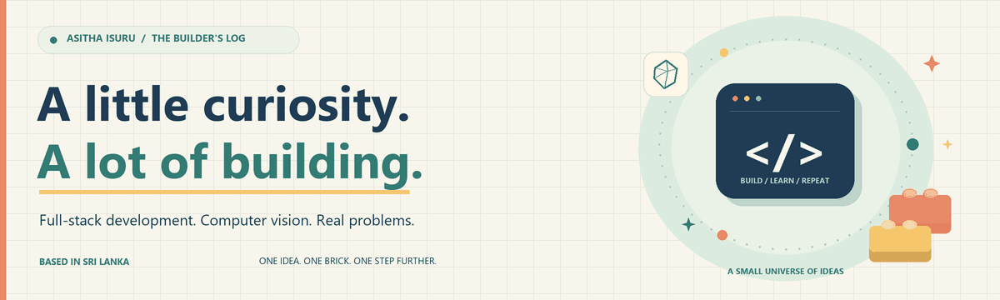
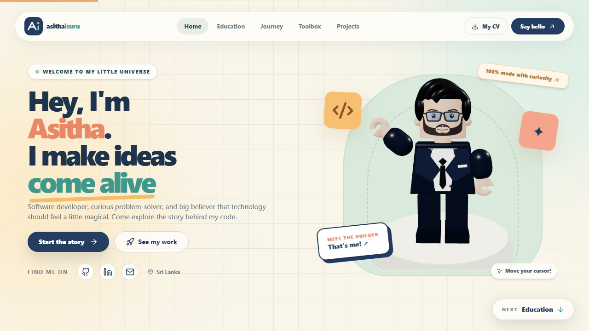

<picture>
  <source media="(prefers-reduced-motion: reduce)" srcset="./assets/profile-banner.png">
  
</picture>

<h1 align="center">Hey, I'm Asitha 👋</h1>

  <strong>Software Engineer · Full-Stack & Backend Developer</strong>

  I build tools that help people get things done. 
  Sometimes that means a business app. Sometimes it means teaching a computer to see.

  
  
  
  

  <a href="#a-little-about-me">About me</a> &nbsp;·&nbsp;
  <a href="#selected-work">Selected work</a> &nbsp;·&nbsp;
  <a href="#my-toolbox">My toolbox</a> &nbsp;·&nbsp;
  <a href="#lets-build-something-useful">Let's connect</a>

## A little about me

I'm a developer from **Gampaha, Sri Lanka**, interested in the space where useful software meets curious ideas. I enjoy connecting the whole system: the interface people use, the services behind it, and the data that makes it work.

- 🧱 **Learning by building** at KeenRabbits (Pvt) Ltd through software development industrial training, working on full-stack business applications.
- 🎓 **B.Sc. (Hons) in Industrial Information Technology** at Uva Wellassa University of Sri Lanka — coursework completed; final results pending. Expected graduation: **June–July 2027**.
- 🔬 **Exploring computer vision and 3D reconstruction**, alongside web applications, APIs, and real-time experiences.
- 🤝 **Happy to talk code, swap ideas, or collaborate** on a practical problem.

## Selected work

### My portfolio, with a little extra personality

A walk through my story, built with **Next.js, TypeScript, Tailwind CSS, React Three Fiber, and Three.js**. Meet my brick-style avatar, explore a galaxy of projects, and find the person behind the code.

**[Take the tour ↗](https://asithaisuru.vercel.app/)** &nbsp;·&nbsp; [Explore the source](https://github.com/asithaisuru/portfolio)

A quick recruiter summary at `/recruiter` is prepared in the local review branch and awaits approved deployment.

### From the workbench

<table>
  <tr>
    <td width="50%" valign="top">
      <h3>💎 Quartz Gemstone Optimizer</h3>
      
From gemstone footage to a 3D model: background masking, COLMAP reconstruction, Open3D mesh processing and React inspection. The cutting optimizer is in a separate research branch; no benchmark gain is claimed for the public reconstruction branch.

      
<code>Python</code> <code>FastAPI</code> <code>React</code> <code>COLMAP</code> <code>OpenCV</code> <code>Open3D</code>

      
<a href="https://github.com/asithaisuru/quartz-optimizer"><strong>Explore the project ↗</strong></a>

    </td>
    <td width="50%" valign="top">
      <h3>🎵 Waveio</h3>
      
LAN/cloud music rooms with shared queues, host recovery and one assigned playback device. SQLite powers LAN persistence; cloud code uses PostgreSQL and a Redis Socket.IO adapter. Production reliability remains to be established; source improvements are under local review.

      
<code>React</code> <code>Node.js</code> <code>Socket.IO</code> <code>SQLite</code> <code>PostgreSQL</code> <code>Redis</code>

      
<a href="https://github.com/asithaisuru/lan-play"><strong>Explore the project ↗</strong></a> · <a href="https://lan-play.vercel.app/">Visit the site</a>

    </td>
  </tr>
  <tr>
    <td width="50%" valign="top">
      <h3>🎓 Project Oasis</h3>
      
Less paperwork, more time for teaching. A class administration dashboard for QR attendance, grades, payments, and email updates.

      
<code>React</code> <code>Express</code> <code>MongoDB</code> <code>REST APIs</code>

      
<a href="https://github.com/asithaisuru/project_oasis"><strong>Explore the project ↗</strong></a>

    </td>
    <td width="50%" valign="top">
      <h3>🧱 Interactive Portfolio</h3>
      
A 3D story and GitHub project explorer, with reduced-motion and non-WebGL paths. A direct recruiter summary is prepared in the local review branch and awaits deployment approval.

      
<code>Next.js</code> <code>TypeScript</code> <code>Three.js</code> <code>React Three Fiber</code>

      
<a href="https://github.com/asithaisuru/portfolio"><strong>Explore the source ↗</strong></a>

    </td>
  </tr>
</table>

[Browse the rest of my repositories →](https://github.com/asithaisuru?tab=repositories)

## My toolbox

Different tools, same goal: make something useful.

**Languages**

**Web & backend**

**Data & computer vision**

**Tools & workflow**

## Let's build something useful

Have an idea, a project, or a question about my work? I'd love to hear from you.

**[Send me an email](mailto:asithafree1@gmail.com)** &nbsp;·&nbsp; [Connect on LinkedIn](https://www.linkedin.com/in/asithaisuru) &nbsp;·&nbsp; [Visit my portfolio](https://asithaisuru.vercel.app/)

---

  Made with curiosity, caffeine, and a few bricks. Thanks for stopping by.

